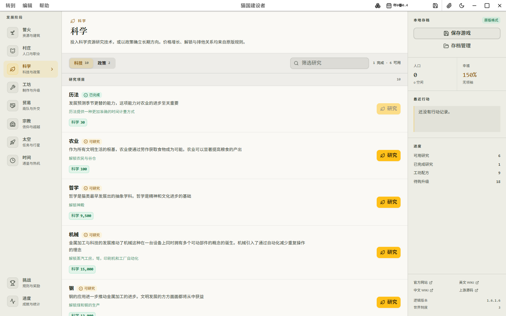

<p align="center">
  
</p>

<h1 align="center">猫国建设者</h1>

<p align="center">
  使用全新桌面界面承载完整 Kittens Game 单机模拟逻辑的非官方重制版。
</p>

<p align="center">
  <a href="#开始使用">开始使用</a> ·
  <a href="#怎么玩">怎么玩</a> ·
  <a href="#存档与数据">存档与数据</a> ·
  <a href="#常见问题">常见问题</a>
</p>



## 关于

猫国建设者不是网页嵌入或套壳。它直接运行固定版本的 Kittens Game 模拟内核，
再用 React 重新实现资源、建造、科学、工坊、贸易、宗教、太空、时间、挑战和
进度界面，同时继续使用原版价格、解锁、生产、季节与存档格式。

项目锁定上游逻辑 `1.6.1.6`。旧版原版存档可以通过压缩文本或存档文件迁移到
本应用；中文和英文界面可在运行时切换，当前进度不会重置。

> [!NOTE]
> 当前仓库尚未发布预编译安装包。若只想试玩，可先使用浏览器开发版；桌面托盘
> 和独立资源浮窗需要运行 Tauri 桌面版。

## 功能

- **完整建设流程**：从采集猫薄荷、建造小屋和图书馆，到研究、贸易、宗教、
  太空、时间线与挑战。
- **原版规则驱动**：建筑价格增长、解锁条件、生产、季节、离线推进和转生继承
  均由固定上游内核计算。
- **桌面化标题栏**：资源、日期与存档操作集中到窗口标题栏，减少游戏内重复栏位。
- **独立资源浮窗**：可吸附在主窗口上方或下方，适合在查看其他窗口时掌握资源。
- **原生存档兼容**：支持压缩文本导出、文件下载、文本或文件导入、恢复点和重置。
- **双语与主题**：中英文即时切换，提供亮色和暗色两套完整配色。
- **键盘与无障碍**：命令面板、快捷保存、焦点管理和语义化标签覆盖主要流程。
- **系统托盘**：可收起主窗口，通过托盘图标快速恢复显示。

## 开始使用

### 环境要求

| 项目     | 要求                        |
| -------- | --------------------------- |
| Node.js  | 18 或更高版本               |
| pnpm     | 9 或更高版本                |
| Rust     | stable，仅运行桌面版时需要  |
| 系统依赖 | 对应平台的 Tauri 2 前置组件 |

Tauri 的平台依赖安装方式见
[官方文档](https://v2.tauri.app/start/prerequisites/)。

### 启动桌面版

```bash
git clone https://github.com/NeserCode-Game/kittens.git
cd kittens
pnpm install
pnpm tauri dev
```

桌面版支持系统托盘和可独立吸附的资源浮窗，是推荐的游玩方式。

### 浏览器预览

只需要查看界面或调试游戏逻辑时，可以运行：

```bash
pnpm dev
```

然后打开 `http://localhost:8888`。浏览器版与桌面版使用不同的本地数据空间，
两者的存档不会自动互通。

### 自行构建安装包

```bash
pnpm tauri build
```

安装包会生成在 `src-tauri/target/release/bundle/`。

## 怎么玩

### 主界面

- 左侧“发展阶段”用于进入营火、村庄、科学、工坊、贸易、宗教、太空和时间。
- 左下角的“挑战”和“进度”分别管理挑战规则、成就、徽章与统计。
- 标题栏资源按钮可打开资源面板，并从中创建独立资源浮窗。
- 标题栏日期按钮显示年份、季节和天数，点击可查看暂停状态与世界刻度。
- 标题栏存档按钮提供快速保存和完整存档管理。
- 窄窗口下通过标题栏左侧按钮打开系统导航。

### 第一次游玩

1. 在“营火”页采集猫薄荷。
2. 将木材精炼到足够数量，建造小屋以增加猫口容量。
3. 建造图书馆并进入“科学”页研究农业、历法等早期项目。
4. 在“村庄”页分配职业，在“工坊”页制作材料和购买升级。

资源解锁和可建造状态会实时更新。按钮不可用时，可查看价格、解锁条件和资源
容量是否满足要求。

### 独立资源浮窗

打开标题栏资源面板，选择“独立显示”。浮窗左上角的猫头是拖动锚点，将其拖动
到主窗口上方或下方即可重新吸附。浮窗关闭后可从同一资源面板再次打开。

## 键盘快捷键

| 快捷键                 | 功能         |
| ---------------------- | ------------ |
| `Ctrl/Cmd + K`         | 打开命令面板 |
| `Ctrl/Cmd + S`         | 快速保存     |
| `Ctrl/Cmd + Shift + S` | 打开存档管理 |

macOS 使用 `Command`，Windows 和 Linux 使用 `Ctrl`。在输入框中输入时，
单独的保存快捷键会让位给文本编辑操作。

## 设置

打开标题栏“转到 > 设置”后可以使用以下页面：

- **搜索**：按名称查找设置，并查看近期搜索与修改记录。
- **通用**：修改窗口标题、界面语言和自动补全。
- **游戏**：调整确认流程、离线进度、显示精度等原版游戏选项。

亮暗主题可从“转到 > 主题模式”切换。游戏设置写入原版存档并立即生效。

## 存档与数据

游戏会自动保存，也支持随时手动保存。存档使用原版
`com.nuclearunicorn.kittengame.savedata` 序列化格式，并保留在本地应用数据中。

建议定期打开“存档管理”导出一份压缩文本或存档文件。导入会替换当前进度，
应用会先把当前可读取存档保存为恢复点；重置存档前仍应先导出手动备份。

> [!IMPORTANT]
> 清除浏览器站点数据、卸载并删除应用数据或重置 WebView 数据都可能删除本地
> 存档。重要进度不要只依赖自动保存。

### 导入原版存档

1. 在标题栏打开“存档管理”。
2. 进入“导入”页。
3. 粘贴原版压缩存档文本，或选择存档文件。
4. 确认导入后等待游戏重新载入。

### 存档损坏或无法读取

检测到损坏存档时，应用会暂停自动保存，避免覆盖原数据。此时可从标题栏打开
存档恢复，导入有效存档或选择已有恢复点。不要先清理应用数据，否则恢复点也会
一并删除。

## 系统托盘

桌面版启动后会创建托盘图标：

- 左键点击：显示、隐藏或恢复主窗口。
- 右键点击：打开托盘菜单。

关闭或隐藏主窗口前，建议确认当前进度已经保存或导出。

## 常见问题

### 为什么资源浮窗没有打开？

浏览器版使用弹出窗口实现独立资源浮窗，可能被浏览器拦截。允许本站弹窗，或直接
运行 Tauri 桌面版。

### 切换语言后进度会丢失吗？

不会。应用会保存当前状态，在目标语言的内核中恢复同一存档，并继续推进游戏。

### 浏览器版和桌面版能共享存档吗？

不会自动同步。可在其中一个版本导出存档，再通过“存档管理 > 导入”迁移到另一个
版本。

### 为什么有些原版在线功能不存在？

本项目聚焦单机玩法与本地存档。原版服务器同步、账号或在线服务相关能力目前未
接入。

### 页面显示不完整怎么办？

桌面窗口最小尺寸为 `800 × 600`。若界面异常，可重新加载应用；持续出现问题时，
请附上操作系统、应用版本和复现步骤提交 Issue。

## 兼容性与范围

- 游戏逻辑基于 Kittens Game `1.6.1.6` 的固定上游提交。
- 项目基于 Tauri 2，可按 Windows、macOS 或 Linux 目标自行构建桌面安装包。
- 支持亮暗主题、中文和英文界面、键盘导航及响应式窄窗口布局。
- 当前未提供云存档、账号同步和在线服务。

## 延伸链接

- [Kittens Game 在线版](https://kittensgame.com/web/)
- [Kittens Game 英文 Wiki](https://wiki.kittensgame.com/en/home)
- [Kittens Game 中文 Wiki](https://lolitalibrary.com/wiki/)
- [问题反馈](https://github.com/NeserCode-Game/kittens/issues)

---

开发架构、测试命令和上游校验方式见
[开发与上游说明](docs/DEVELOPMENT.md)。第三方许可与使用限制见
[THIRD_PARTY_NOTICES.md](THIRD_PARTY_NOTICES.md)。

> [!WARNING]
> Kittens Game 的上游逻辑和随附资源使用 WET PAWS 许可，仅允许个人或教育用途，
> 禁止商业使用或商业衍生。使用或分发前请阅读第三方许可说明。
